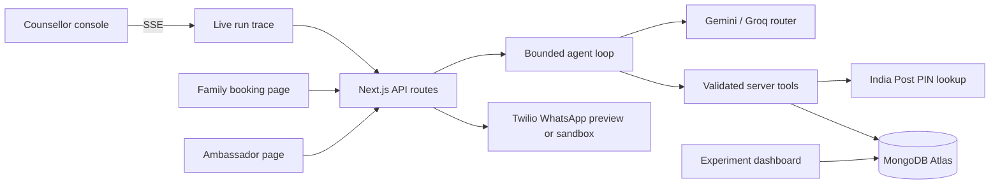

# ParentBridge — Agentic AI for Multilingual Education Support

ParentBridge is an agentic AI portfolio project that helps families explore an education programme by connecting them with a parent ambassador from a similar region and language community. It demonstrates a complete, human-centered agent workflow: gathering evidence, finding a match, preparing a conversation, coordinating a booking, and summarising the outcome.

The application uses a **synthetic education scenario**. Names, family notes, phone numbers, and outcomes are fictional. ParentBridge is a prototype for exploring agent orchestration and guardrails; its simulated experiment is not evidence of real-world impact.

## What the agent does

The matching agent runs a bounded function-calling loop. It reads a lead, extracts and verifies the family's concerns, resolves the district from a PIN code, searches eligible parent ambassadors, scores candidates using verified facts, and prepares a multilingual brief and WhatsApp offer. The counsellor can inspect the trace and results before a message is sent.

After a call, a second agent turns notes or a voice-note transcript into a structured summary. A deterministic scanner checks for overpromises, such as guaranteed jobs, placements, salaries, or fee discounts.

## Project highlights

- **Tool-using agent:** up to eight model turns, parallel execution for independent tools, schema-validated arguments, and server-side tool execution.
- **Observable runs:** live server-sent event trace with model/provider, tool inputs and outputs, token use, duration, and saved run history.
- **Grounded matching:** district, language, university, student year, availability, consent, and weekly capacity are checked in application code.
- **Multilingual communication:** family offers and ambassador briefs support English, Telugu, Hindi, Tamil, Kannada, and Malayalam, with native-script checks.
- **Safety checks:** no phone numbers are sent to the model, source quotes are checked against lead notes, outbound messages require consent, and generated claims are validated.
- **Reliable model routing:** Gemini with a configurable fallback model and Groq fallback, per-call timeouts, bounded retries, and clear failure states.
- **End-to-end workflow:** lead console, booking page, ambassador call notes, AI summary, and an experiment dashboard.
- **Synthetic experiment:** seeded treatment/control data and a simulation mode for exploring funnel metrics without presenting simulated outcomes as real results.

## Demo flow

1. Open **Run the agent on a stalled family** from the landing page.
2. Follow the live tool-call trace and inspect the family's extracted concerns and the selected ambassador.
3. Review the ambassador brief and the multilingual WhatsApp offer.
4. Use the booking page to choose a slot and record consent.
5. Open the ambassador demo page, submit sample call notes, and review the AI summary and red flags.
6. Explore the dashboard using the included synthetic data or the simulation control.

The WhatsApp integration runs in preview mode unless Twilio sandbox credentials and a demo recipient are configured. The demo is designed to avoid sending messages to arbitrary numbers.

## Architecture



### Agent tool sequence

| Tool | Purpose |
| --- | --- |
| `get_lead` | Loads the family record and counselling notes. Phone numbers stay on the server. |
| `extract_doubts` | Stores structured concerns and checks quoted text against the original notes. |
| `resolve_district` | Resolves a PIN code through India Post, with a short timeout and local cache fallback. |
| `search_ambassadors` | Finds active, consented parents within their weekly call limit, prioritising district, state, university, and language fit. |
| `score_candidates` | Ranks candidates; verified match facts are attached by the server. |
| `create_match` | Persists the selected candidate and matching rationale. |
| `write_ambassador_brief` | Creates a native-language brief and English translation with questions and do-not-say guidance. |
| `draft_family_message` | Creates a short, localized WhatsApp offer with a booking placeholder and opt-out line. |

Tool arguments are validated with Zod before execution. Results are persisted in the agent run and streamed to the browser. The loop stops after eight model turns, and the final result is schema-validated before it is shown.

## Stack

- Next.js 16, React 19, TypeScript
- Gemini and Groq through a shared tool-calling interface
- MongoDB Atlas with Mongoose
- Twilio WhatsApp sandbox integration with a safe preview fallback
- India Post public PIN-code data/API
- Zod, Vitest, ESLint

## Run locally

```bash
npm install
cp .env.example .env.local
npm run seed
npm run dev
```

Set `MONGODB_URI` and at least one model provider API key in `.env.local`. The seed script creates synthetic demo records. WhatsApp credentials are optional; without them, the app shows a preview and handoff link.

Useful scripts:

```bash
npm run agent:test       # Run the agent against showcase families
npm run demo:prerun      # Save showcase agent runs
npm run demo:reset       # Reset demo records
npm test                 # Run unit tests
npm run typecheck        # Check TypeScript types
npm run lint             # Run ESLint
```

See [.env.example](.env.example) for the full environment variable list.

## Privacy and safety design

- All seeded family and ambassador data is fictional.
- The model receives no phone numbers; the server retains contact details for workflow delivery.
- WhatsApp messages are sent only after explicit consent and include an opt-out instruction.
- Tool inputs are schema-validated, and generated quotations are checked against source notes.
- Job, placement, salary, and fee promises are prohibited in generated offers and flagged in call summaries.
- Public demo agent runs are rate-limited; stored IP identifiers are salted hashes.
- Simulation events are marked as simulated and kept distinguishable from real demo activity.

## Limitations

- Seeded outcomes and the 21-day simulation are illustrative assumptions, not measured results.
- The demo has no authentication and is intended for review with synthetic data.
- Calendar availability is simplified, and demo call links use public Jitsi rooms.
- AI language and script checks do not guarantee translation quality or factual correctness; outputs should be reviewed before use.
- Free-tier provider availability can add latency or cause a run to fail; errors are surfaced instead of returning fabricated results.
